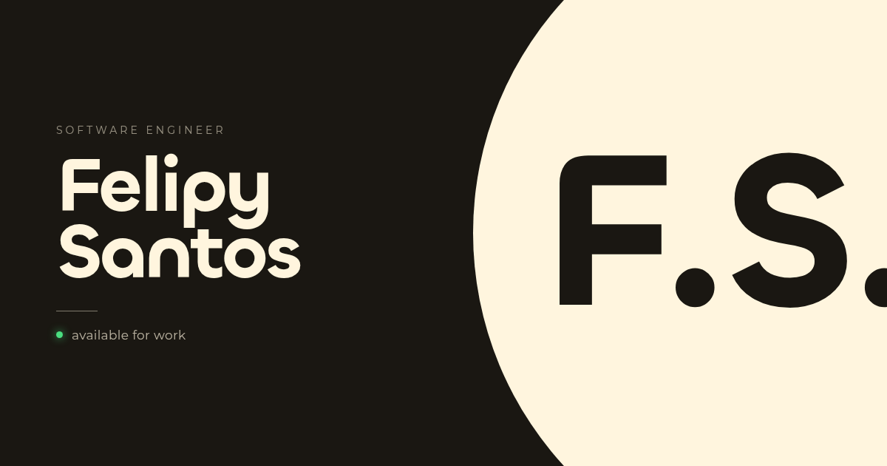

# Felipy Santos — Portfolio



Personal portfolio of Felipy Santos, a software engineer building fast, scalable web applications with Next.js and Spring Boot.

**Live:** [felipysantsss.vercel.app](https://felipysantsss.vercel.app) · available in European Portuguese (default), English and Spanish.

## Features

- **Three languages:** pt-PT at `/`, English at `/en` and Spanish at `/es`. Switching language from the footer swaps the copy in place, without reloading the page or replaying the intro.
- **Project showcase:** a bento grid of compact cards; each one opens an animated side drawer with the cover, full description, stack and a link to the case study.
- **Motion:** a short intro that any click, key or scroll fast-forwards, letter-by-letter headlines, sections that reveal as they scroll in, project cards with a parallax index number, a marquee that speeds up with the scroll and magnetic buttons, all on Lenis smooth scrolling. Everything stops under `prefers-reduced-motion`.
- **CV:** view or download from the about section; each locale can point to its own PDF.
- **Creative 404:** the zero of "404" is an eye that follows the cursor, localized like the rest of the site.
- **SEO:** per-locale metadata, `hreflang` alternates, sitemap, robots, JSON-LD (`Person`), a 1200×630 share image and [`llms.txt`](public/llms.txt).
- **Performance:** every locale is prerendered at build time, the fonts are WOFF2 (Montserrat subset to Latin) and the flags load only near the footer.
- **Accessibility:** semantic landmarks, a keyboard-friendly drawer (native modal `<dialog>` with focus trap and Escape), visible focus states, and split headlines that screen readers hear as whole words.

## Tech stack

| Area | Tools |
| --- | --- |
| Framework | [Next.js 16](https://nextjs.org) (App Router, Turbopack, React Compiler), React 19, TypeScript |
| Styling | [Tailwind CSS v4](https://tailwindcss.com) |
| i18n | [next-intl 4](https://next-intl.dev) |
| Motion | [GSAP](https://gsap.com) + `@gsap/react`, [Lenis](https://lenis.darkroom.engineering) |
| Flags | [flag-icons](https://github.com/lipis/flag-icons) |
| Hosting | [Vercel](https://vercel.com) |

## Getting started

Requires Node.js 20.9 or later.

```bash
npm install
npm run dev      # http://localhost:3000
```

| Script | What it does |
| --- | --- |
| `npm run dev` | Starts the development server |
| `npm run build` | Creates the production build (prerenders `/pt`, `/en` and `/es`) |
| `npm run start` | Serves the production build |
| `npm run lint` | Runs ESLint |

## Project structure

```text
messages/                  Copy for each locale (pt.json, en.json, es.json): UI text, projects, experience, CV
public/
  cv/                      CV PDFs
  images/                  Experience logos
  og-image.png             Social share image (1200×630)
  llms.txt                 Plain-text summary for AI crawlers
src/
  app/
    [locale]/
      layout.tsx           Root layout: fonts, SEO copy and metadata, JSON-LD, providers
      page.tsx             Home page: header, sections and footer
      not-found.tsx        Localized 404
      [...rest]/page.tsx   Sends unknown paths to the 404
    fonts/                 Chillax and Montserrat (WOFF2)
    globals.css            Tailwind theme, utilities and keyframes
    robots.ts, sitemap.ts
  components/
    components-home/       Home sections: hero (Initialize), Work, project cards and drawer, About, Contact
    SplitChars.tsx         Letter-by-letter headline text
    LocaleProvider.tsx     Client-side language switching
    SwitchLanguage.tsx     Footer language switcher
    NotFoundView.tsx       404 page content
  data/                    Skills and contact links
  i18n/                    Routing, request config and navigation helpers
  lib/motion.ts            Shared motion tokens, scroll reveals (data-reveal) and magnetic hover
  proxy.ts                 Locale detection and redirects (Next.js 16 proxy, formerly middleware)
```

## Editing content

All copy lives in `messages/*.json`. Keep the same keys in the three files.

- **Projects:** add an entry to the `workcases` array in each locale with `id`, `imageSrc`, `data` (period), `title`, `description`, `stack` and `url`. Covers are shown at 3:2, so 2400×1600 works well. Images from a new host must be allowed in `images.remotePatterns` in [`next.config.ts`](next.config.ts).
- **Experience:** `about.experiences`.
- **CV:** put the PDF in `public/cv/` and point `about.cv.file` to it in each locale.
- **Skills and contacts:** [`src/data/skills.json`](src/data/skills.json) and [`src/data/contacts.json`](src/data/contacts.json). The JSON-LD in the layout lists the skills too (`knowsAbout`).
- **SEO copy:** `seoCopy` in [`src/app/[locale]/layout.tsx`](src/app/%5Blocale%5D/layout.tsx).
- **Share image:** replace `public/og-image.png`, keeping it at 1200×630.

### Montserrat subset

Montserrat is subset to the Latin range used by the three locales. To support another alphabet, regenerate it from the original variable font with [fontTools](https://github.com/fonttools/fonttools) (`pip install fonttools brotli`):

```bash
pyftsubset Montserrat-VariableFont_wght.ttf \
  --unicodes="U+0000-00FF,U+0131,U+0152-0153,U+02BB-02BC,U+02C6,U+02DA,U+02DC,U+0304,U+0308,U+0329,U+2000-206F,U+20AC,U+2122,U+2191,U+2193,U+2212,U+2215,U+FEFF,U+FFFD" \
  --layout-features='*' --flavor=woff2 \
  --output-file=src/app/fonts/Montserrat-Variable-Latin.woff2
```

## Credits

- [Chillax](https://www.fontshare.com/fonts/chillax) by Indian Type Foundry, under the ITF Free Font License.
- [Montserrat](https://github.com/JulietaUla/Montserrat) by the Montserrat Project Authors, under the SIL Open Font License 1.1.
- Flags from [flag-icons](https://github.com/lipis/flag-icons) (MIT).

## Contact

- Email: [felipysantos@proton.me](mailto:felipysantos@proton.me)
- LinkedIn: [linkedin.com/in/felipysantsss](https://www.linkedin.com/in/felipysantsss)
- GitHub: [github.com/FeSantsss](https://github.com/FeSantsss)
- Behance: [behance.net/tercetime](https://www.behance.net/tercetime/)
